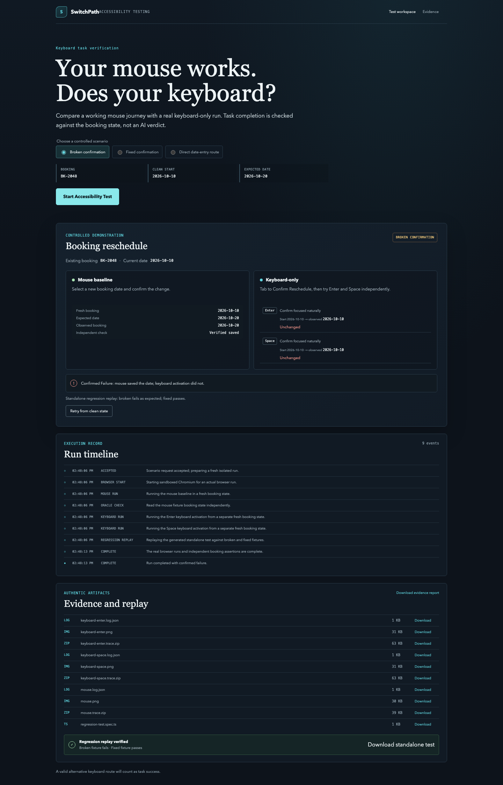
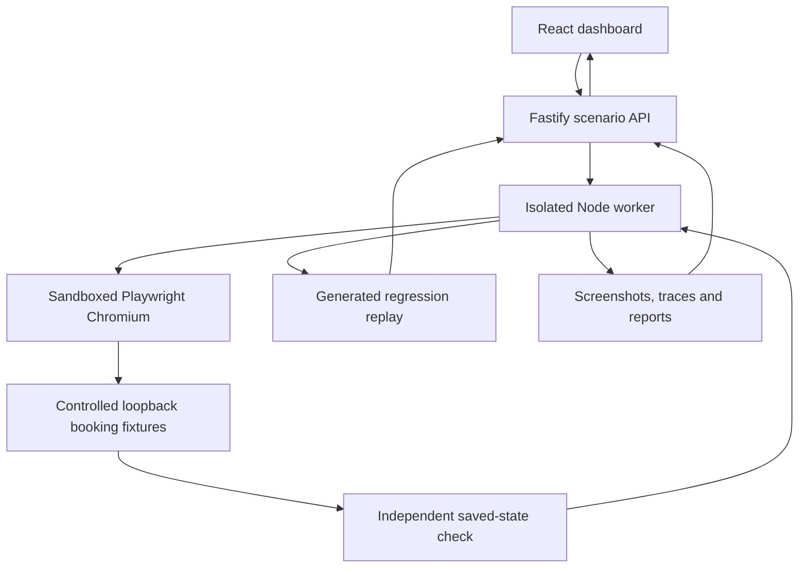

# SwitchPath

**Your mouse works. Does your keyboard?**

A control can respond to a mouse click and still prevent a keyboard user from completing the same task. SwitchPath compares real mouse and keyboard booking journeys from equivalent clean states, then checks the saved booking date independently.

This is a controlled accessibility-testing proof of concept for frontend developers and QA engineers. Runtime action plans are deterministic: no AI model, external API key or paid service is required. AI-assisted development does not make the runtime an AI evaluator.

## What it does

- Runs broken confirmation, fixed confirmation and direct date-entry scenarios in sandboxed Chromium.
- Compares mouse, Enter, Space and the supported alternative route using separate initial states.
- Shows observed dates, actual progress, timelines and downloadable reports, screenshots, traces and logs.
- Generates a Playwright test from a fixed template and replays it against broken and fixed fixtures.
- Distinguishes task failure from browser/infrastructure errors; offers clean retry for unsuccessful runs.

## See the results

[](docs/images/broken-desktop.png)

The mouse and keyboard outcomes differ even though both can reach the confirmation control. The independent booking-state read establishes the result.

[Explore all six screenshots](docs/GALLERY.md) · [Follow the demonstration](docs/DEMO_WALKTHROUGH.md) · [Review verification evidence](docs/TESTING.md)

## How the investigation works

1. Open the dashboard and choose one of the three built-in scenarios. Arbitrary websites are not supported.
2. Select **Start Accessibility Test**. The API reserves the single worker before asynchronous setup.
3. Run a mouse baseline against a fresh fixture and read its saved booking state.
4. Run keyboard input from separate equivalent states; keyboard completion does not use mouse clicks.
5. Compare the independently observed dates with the expected date.
6. Inspect the outcome, timeline and available artifacts. Infrastructure failures are Test Error / Test Incomplete, not accessibility defects.
7. For a reproduced broken journey, generate and execute the template-based regression test.
8. Confirm that replay fails on the broken fixture and passes on the fixed fixture. Download evidence before it expires.

## Architecture



React and TypeScript implement the dashboard; Vite builds it. Fastify validates requests and coordinates runs. Playwright drives Chromium. Node.js runs the API and worker. See [implementation notes](docs/ARCHITECTURE.md).

## Run locally

Use Node.js 22.12+ or a supported newer Node release, npm, and Playwright Chromium. The release was verified on Apple Silicon macOS with Node 24.15.0 and npm 12.1.0. Run commands from the repository root.

```sh
npm ci
# Keep browser downloads and temporary evidence inside this checkout.
mkdir -p .cache/tmp
export PLAYWRIGHT_BROWSERS_PATH="$PWD/.cache/browsers"
export TMPDIR="$PWD/.cache/tmp"
npx playwright install chromium
npm run dev
```

Open http://127.0.0.1:5173. The API runs on loopback port 3000; Vite proxies `/api`. Use a trusted local machine or private Codespaces preview. The development server binds to all interfaces; do not expose its port publicly. If Chromium cannot run sandboxed, fix the host environment; do not disable its sandbox.

To serve the built dashboard locally, stop the development servers first:

```sh
npm run build
npm start
```

Open http://127.0.0.1:3000. Keep the browser-path and temporary-directory exports in this shell. `npm start` requires the source tree and installed dependencies, not just `dist/`. Setting `NODE_ENV=production` makes the server bind to all interfaces; public hosting is deferred pending security, resource and cost verification.

## Commands and sample results

| Command | Purpose |
| --- | --- |
| `npm run dev` | Start API and Vite development server |
| `npm run build` | Type-check and build the frontend |
| `npm start` | Serve the built dashboard and API |
| `npm test` | Backend unit/integration checks |
| `npm run test:e2e` | Chromium browser suite |

| Scenario | Mouse saved date | Keyboard saved date | Expected result |
| --- | --- | --- | --- |
| Broken confirmation | 2026-10-20 | 2026-10-10 for Enter and Space | Confirmed Failure after replay |
| Fixed confirmation | 2026-10-20 | 2026-10-20 for Enter and Space | Passed |
| Direct date entry | 2026-10-20 | 2026-10-20 through alternate route | Passed |

All journeys start at the fixed fixture date 2026-10-10. These dates are test data, not the current date.

## Verification

The recorded Mac verification passed the production build, **12 backend tests** and **5 Chromium E2E tests**. Source/test fingerprints were checked against that run during publication preparation; the suites were not rerun for documentation edits. Five recorded axe scans found no detected violations, with contrast checks incomplete. This does not establish full WCAG conformance.

See [test commands, logs and limitations](docs/TESTING.md). Screen-reader, complete manual contrast and cross-browser verification remain incomplete.

## Evidence and regression replay

Download evidence before it expires. Run records live in memory, with up to 32 records, approximately ten-minute retention (pruned every minute), and cleanup on application close. Temporary artifacts are not durable storage.

A broken run automatically executes the generated test against both fixtures. To replay a downloaded test manually, save it as `tests/generated/switchpath-regression.spec.ts` (its imports are relative to that directory), then run:

```sh
SWITCHPATH_REGRESSION_MODE=1 SWITCHPATH_REGRESSION_VARIANT=broken npx playwright test
SWITCHPATH_REGRESSION_MODE=1 SWITCHPATH_REGRESSION_VARIANT=fixed npx playwright test
```

The broken command is expected to exit 1 with a booking-date assertion failure; fixed should exit 0. Replay launches its own controlled fixture and does not require the dashboard server. The test is standalone within this repository, not portable without its fixture module and Playwright configuration. To inspect a downloaded trace locally: `npx playwright show-trace /path/to/trace.zip`.

## Repository map

- `src/client/`: dashboard and styles.
- `src/server/`: API, booking fixture and backend tests.
- `src/runner/`: browser worker and regression source template.
- `tests/`: scenario and dashboard browser tests.
- `docs/`: screenshot gallery, walkthrough, architecture and verification.
- `devpost/scope.md`, `prd.md`, `spec.md`: recovered original planning; historical optional directions are not claims of implemented features.

## Security and limitations

The API accepts only `broken`, `fixed` or `alternative`, rejecting extra fields. There is no arbitrary URL, script, selector or browser-control endpoint. Browser requests are restricted to the exact fixture origin and service workers are blocked. Worker environment variables are allowlisted; console logs receive token-pattern redaction. Request bodies are capped at 1 KB, starts at five per minute per client outside test mode, and worker execution at 120 seconds. Evidence inventory applies file/type/count/size checks (16 entries and 10 MiB per run). These application controls are not an OS-level network sandbox or a public multi-tenant security guarantee. There is no user authentication.

Only three controlled scenarios are supported. Booking state is in memory and artifacts expire. No public deployment or multi-user production service is claimed.

## Project status and contributing

SwitchPath is a completed, publicly available proof of concept featuring three controlled accessibility scenarios, mouse-versus-keyboard comparisons, independent booking-state verification, and generated Playwright regression tests.

The source code, documentation, screenshots, and recorded verification evidence are published. The project has not been deployed as a public production service. Screen-reader, full manual accessibility, and cross-browser verification remain outside the completed testing scope.

For a contribution, describe a reproducible issue and the affected scenario. Keep the scenario-only API, sandboxing and independent outcome checks intact. Run the relevant checks in [testing](docs/TESTING.md); do not include credentials, generated output or personal data.

## License and ownership

Project owner: **Putluru Sandeep**. Licensed under [MIT](LICENSE). Third-party dependencies retain their own licenses. Copilot-assisted planning and Codex-assisted release work are disclosed in [planning provenance](docs/PLANNING.md).
