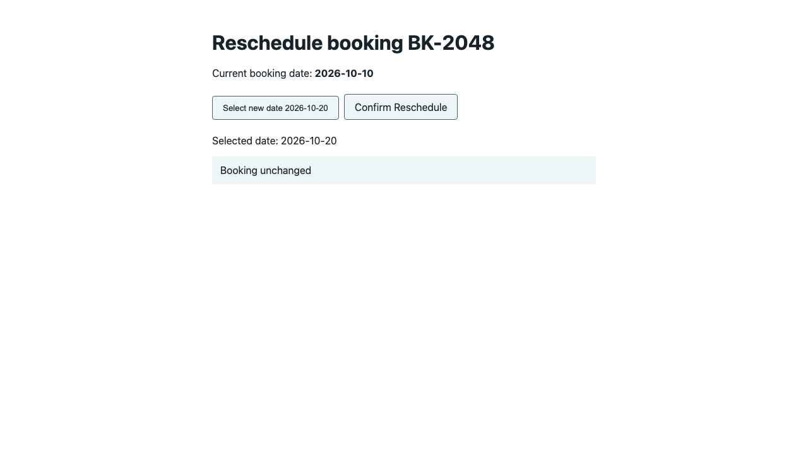
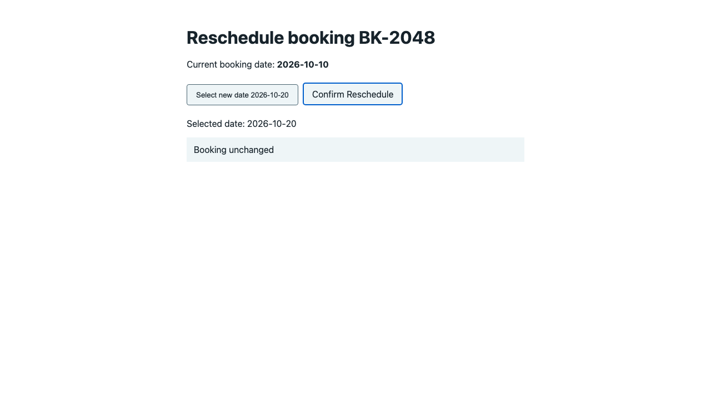
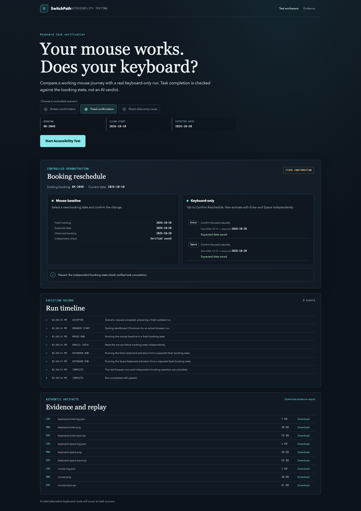
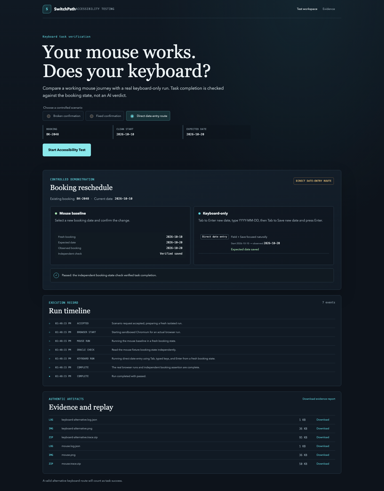
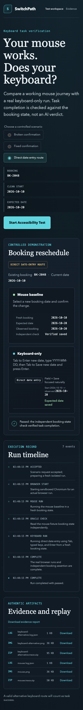

# Screenshot gallery

Recorded application evidence, preserved without pixel edits. Screenshots illustrate states; test logs and independent assertions establish execution outcomes. Click any image for full size.

### Broken confirmation

Dashboard: mouse saved October 20; Enter and Space left October 10 unchanged. The result also records broken/fixed regression replay. [Original evidence](../devpost/demo-assets/broken-desktop.png).

### Mouse interaction snapshot

The fixture shows October 20 selected, with the visible booking status still unchanged. This intermediate screenshot does not prove a saved booking; use the independent result in the dashboard and report. [Original evidence](../devpost/demo-assets/mouse.png).

### Keyboard interaction snapshot

The Confirm Reschedule control has visible keyboard focus, but the displayed booking remains unchanged. The report separately records the failed Enter outcome. [Original evidence](../devpost/demo-assets/keyboard-enter.png).

### Verified improvement

The native-button fixture passes mouse, Enter and Space checks; each observed booking date is October 20. [Original evidence](../devpost/demo-assets/fixed-desktop.png).

### Alternative desktop route

Direct date entry reaches the expected saved date using keyboard input. A valid alternative counts as task success. [Original evidence](../devpost/demo-assets/alternative-desktop.png).

### Responsive dashboard

A narrow dashboard layout stacks comparison panels and evidence. This is layout evidence, not mobile-device or screen-reader certification. [Original evidence](../devpost/demo-assets/alternative-mobile.png).
